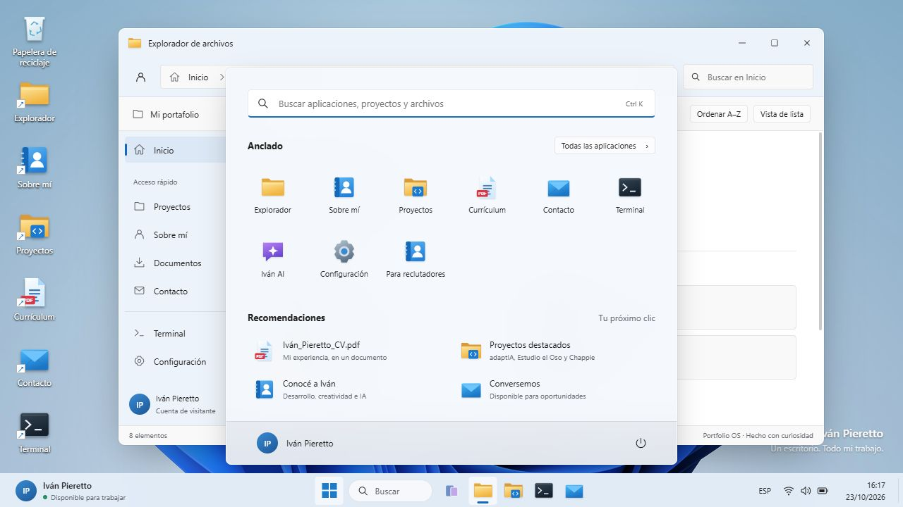

# Iván Pieretto · Portfolio OS

Portafolio interactivo inspirado en el escritorio de Windows 11. Los proyectos, el perfil, las habilidades, los canales de contacto y el CV original se presentan como aplicaciones de un escritorio web.



Capturas adicionales: [Explorador](docs/desktop.png) · [Vista móvil](docs/mobile.png).

## Experiencia Windows 4.0

- Inicio con pantalla de bloqueo, escritura automática de la contraseña de demostración y bienvenida. Enter permite acelerar la entrada; «Entrar ahora» omite la espera. Se puede desactivar la presentación desde Accesibilidad.
- Galería de 12 fondos, imagen propia guardada en IndexedDB local, ajustes de relleno y presentación automática cada minuto.
- Temas claro, oscuro y del equipo; transparencia, contraste elevado, alineación de barra, búsqueda y tamaños de iconos.
- Ejecutar (`Ctrl + Alt + R`), menú de acceso rápido, menú de ventana con movimiento y tamaño mediante flechas, diseños en mitades, tercios, cuadrantes y ventanas amplias.
- Hasta ocho escritorios virtuales. Las ventanas se pueden mover entre ellos; cerrar un escritorio conserva sus aplicaciones en otro.
- Administrador de tareas para las ventanas del portafolio, anclar/desanclar apps, renombrar accesos, papelera recuperable y deshacer la eliminación de un acceso con `Ctrl + Z`.
- Guía de más de 30 acciones de teclado con combinaciones Windows y alternativas para la web. Los atajos que recibe el navegador se manejan dentro del portafolio; las combinaciones reservadas por Windows o el navegador no pueden reemplazarse desde esta página.
- Cada proyecto tiene una captura local que se puede ampliar con clic y cerrar con Esc. adaptIA y Estudio el Oso muestran sus páginas públicas; Chappie muestra su interfaz original sin iniciar los servicios de voz o IA.

La tecla Windows no es necesaria para explorar el sitio: todas las funciones tienen controles visibles o alternativas de teclado. «Suspender», «Reiniciar» y «Apagar» solo afectan este escritorio web.

## Ejecutar

Requiere Python 3 para el servidor local. No necesita instalar paquetes.

```sh
python server.py
```

Abrí **http://localhost:3000**. También podés usar `python -m http.server 3000` desde esta carpeta. Es necesario servirlo por HTTP: abrir `index.html` con doble clic no carga los módulos ES en todos los navegadores.

Si el puerto está ocupado, usá `python server.py --port 8188` y abrí **http://127.0.0.1:8188**. El servidor de desarrollo escucha solo en el equipo local.

## El escritorio

- Barra de tareas de ancho completo, Inicio centrado, búsqueda, aplicaciones ancladas e indicadores de ventana activa.
- Inicio con búsqueda sin acentos, lista de aplicaciones, recomendaciones y opciones para bloquear o reiniciar el escritorio.
- Ventanas con controles a la derecha, arrastre, ocho bordes de redimensionamiento, foco, minimizado, restaurado y maximizado. Los extremos de la pantalla permiten acoplar a la izquierda, derecha o maximizar; también hay botones al pasar por Maximizar.
- Explorador con accesos rápidos, archivos recomendados, búsqueda, ordenación y cambio de vista.
- Accesos de escritorio con selección, doble clic, teclado y reordenamiento al arrastrarlos sobre otro acceso. El orden se guarda en el navegador. En dispositivos táctiles, un toque abre la aplicación.
- Temas claro y oscuro, Bloom, fondos originales del proyecto, colores de énfasis y preferencias persistentes.
- Calendario navegable, panel de configuración rápida y vista de tareas.
- Currículum con vista previa, transcripción y descarga del PDF original.
- Resumen para reclutadores, proyectos, perfil, contacto, terminal y asistente de preguntas sobre el portafolio.
- Diseño adaptable: en móviles, las ventanas ocupan el espacio disponible y la barra permite desplazar las aplicaciones si hay muchas abiertas.

La terminal incluye `help`, `about`, `projects`, `skills`, `contact`, `neofetch`, `whoami`, `dir`, `date`, `clear`, `open [aplicación]` y `theme [light|dark]`, además de los easter eggs originales (`coffee`, `matrix`, `doom`, `sudo hire-me`, `secrets`). DOOM carga un emulador de Archive.org al ejecutarlo y requiere conexión. El resto del escritorio usa recursos locales.

El asistente ofrece respuestas predefinidas locales; no está conectado a un servicio de IA. El formulario de contacto valida los campos y abre el cliente de correo del visitante mediante `mailto:`; el envío se completa allí. La pantalla de bloqueo es parte de la experiencia visual y no implementa autenticación.

## Atajos

| Atajo | Acción |
| --- | --- |
| `Ctrl / Cmd + K` | Buscar aplicaciones |
| `Ctrl + Alt + D` | Mostrar / restaurar el escritorio |
| `Ctrl + Alt + ← / →` | Acoplar la ventana activa |
| `Ctrl + Alt + ↑ / ↓` | Maximizar / restaurar o minimizar |
| `Ctrl + F6` | Cambiar entre ventanas del escritorio |
| `Esc` | Cerrar paneles |
| `Enter / Espacio` | Abrir un acceso enfocado |
| `↑ / ↓` en el escritorio | Mover el foco entre accesos |
| `↑ / ↓` en la terminal | Recorrer el historial |

Los atajos globales funcionan también desde los campos; las operaciones habituales de edición y AltGr conservan su comportamiento nativo. La aplicación «Atajos de teclado» contiene la lista completa. Los paneles mantienen la navegación con Tab dentro de sus controles. Se respeta `prefers-reduced-motion` y se pueden desactivar las transiciones en Configuración.

## Organización

```text
index.html                   Shell y templates del contenido original
style.css                    Tokens, temas, shell, aplicaciones y responsive
app.js                       Inicio y coordinación de la interfaz
js/
  window-manager.js          Ciclo de vida, foco, arrastre y tamaño de ventanas
  geometry.js                Geometría de pantalla, límites y acoplamiento
  desktop.js                 Accesos, selección y reordenamiento
  apps.js                    Explorador, Configuración, Terminal y contenido
  preferences.js             Tema, fondos, énfasis y movimiento
  icons.js                   SVG compartidos y arte vectorial de aplicaciones
  config.js                  Registro de aplicaciones y almacenamiento seguro
  login.js, login-sequence.js Bloqueo, escritura automática y bienvenida
  wallpapers.js              Galería y almacenamiento local de imagen propia
  settings.js                Secciones de configuración y guía de atajos
  shortcuts.js               Combinaciones de teclas y comandos de Ejecutar
  desktop-state.js            Nombres, orden y papelera de accesos
  system-apps.js              Administrador de tareas y ventanas del sistema
  project-previews.js         Capturas HD, clips al pasar el mouse y visor ampliado
assets/                      Fondos Bloom, favicon y créditos
terminal-easter-eggs.js       Easter eggs originales del proyecto
Ivan_Pieretto_CV.pdf          CV original descargable
cv_ivan_pieretto.jpg          Vista previa original del CV
wallpaper.jpg, wallpaper2.jpg Fondos originales
server.py                    Servidor local de desarrollo
tests/                       Pruebas de geometría con node:test
```

Se eliminaron las implementaciones duplicadas del gestor anterior, los controles semáforo, la magnificación del dock, la dependencia de animaciones GSAP y el CSS de utilidades que ya no se utiliza. Las plantillas conservan el contenido y los enlaces originales, y usan eventos declarados desde JavaScript en lugar de handlers HTML inline.

## Verificar

Node.js 18 o superior permite ejecutar las verificaciones, sin `npm install`:

```sh
npm run check
npm test
```

Las 19 pruebas verifican geometría, acoplamiento, regreso de móvil a escritorio, temporizadores de inicio, omisión y cancelación de la animación, atajos, AltGr, comandos de Ejecutar, preferencias y conservación de ventanas entre escritorios virtuales. Las interacciones de navegador se revisaron manualmente con automatización de UI; no hay una suite E2E incluida. Los detalles de la revisión se encuentran en `VALIDATION.md`.

## Publicar

Es una aplicación estática sin compilación. Serví la raíz del proyecto por HTTPS con los archivos HTML, CSS, JS y recursos, conservando la carpeta `js/`. Puede mantenerse el hosting estático existente. La rama del refactor no cambia la versión publicada hasta integrarla en la rama de despliegue.

## Créditos

Windows y Bloom pertenecen a Microsoft y sus respectivos autores. Este es un portafolio independiente inspirado en su interfaz. Consultá `assets/README.md` para los créditos de los fondos. El contenido profesional y el CV pertenecen a Iván Pieretto.
